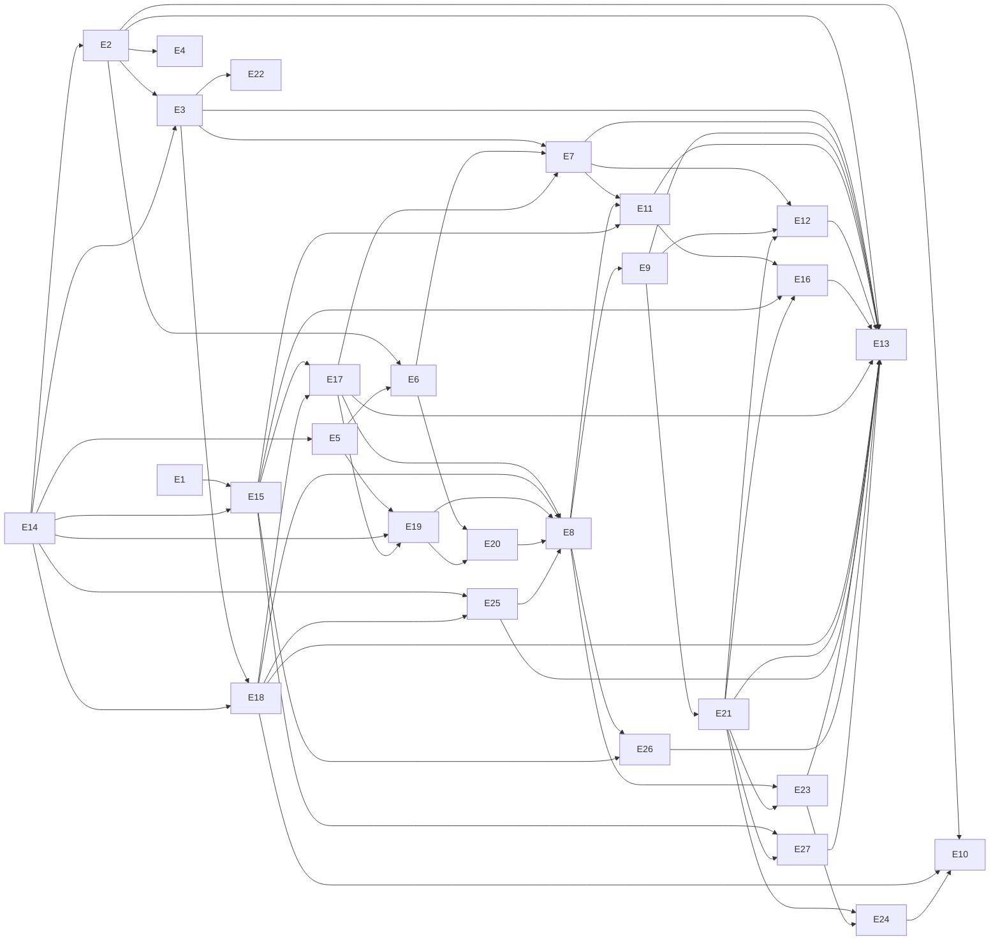

# Caminho crítico

A cadeia mais longa até o fechamento tem 12 entregáveis. Entregáveis em alguma cadeia desse comprimento que termina em E13: E14, E2, E3, E18, E17, E19, E20, E8, E9, E21, E23, E16, E27, E12, E13. Só ordem; não há datas (DEC-003).

Publicações, na ordem: E17 (compatível), E11 (versão de quebra), E16 e E13 (DEC-014, DEC-015). As medições de política E26 e E27 não seguram publicação (DEC-047).

Próximo portão por trilha (o estado atual está em `state.md`):

- decisions: nenhuma decisão do executor pendente (DEC-085 a DEC-087 ratificadas); as sondas de E14 e os experimentos de DEC-052 estão concluídos.
- measurement: E1 na branch de release; depois que entrar em `main`, a linha de base de E15.
- engineering: specs de E2 e E5 aprovados, depois de E14.
- release: branch de release e tag da versão atual criadas (DEC-002, DEC-036); primeira publicação em E17.
- external: nenhum.
