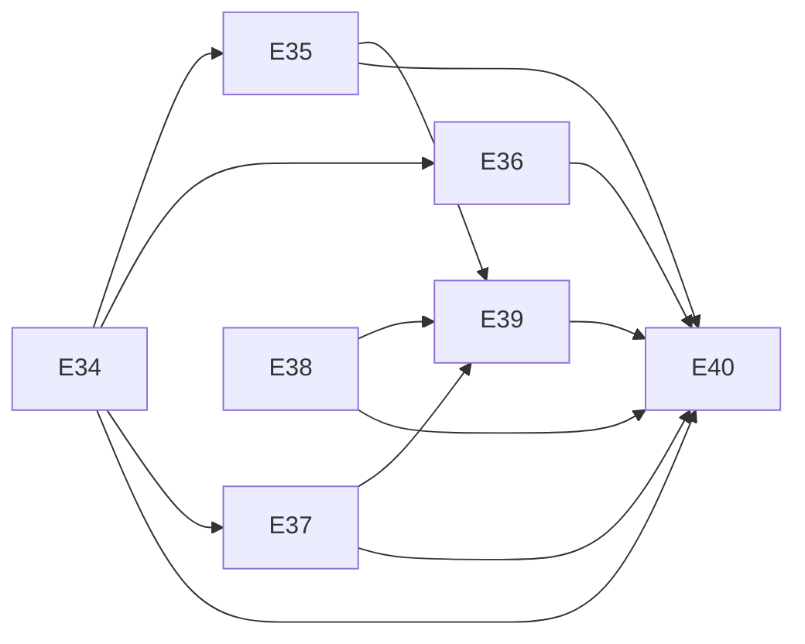

# Caminho crítico

Caminho crítico: E34 -> E35 -> E39 -> E40. Próximo marco por trilha: engineering -> E36 e E37 (E34 e E38 publicados na 2.4.0); release -> E40 com alvo de versão a redefinir na estratégia v1.1; measurement -> lote pago de confirmação de E35 (AC2), seguido de E39.
