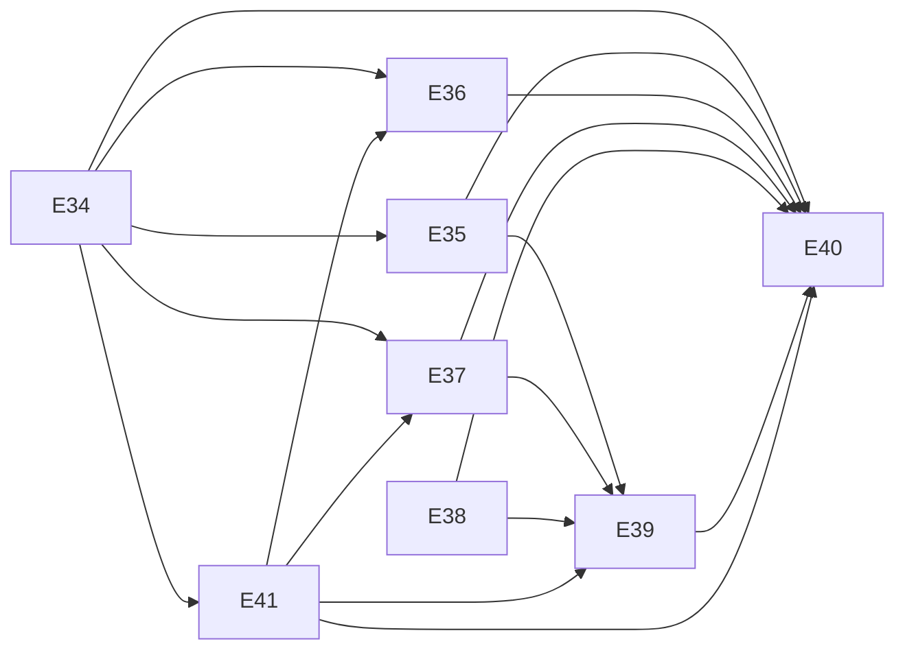

# Caminho crítico

Caminho crítico: E41 -> E37 -> E39 -> E40 (E34 já publicado na 2.4.0). Próximo marco por trilha: engineering -> E36 e E37 em série (E41 publicado na 2.5.0, 6abab96); release -> 2.5.0 publicada com o E41 (DEC-042); E40 publica a versão seguinte, a definir na revisão da estratégia; measurement -> lote pago de confirmação de E35 (AC2) e sonda AC2b de E41 registrada (conferência H1 do dono pendente; DEC-029), seguidos de E39.
