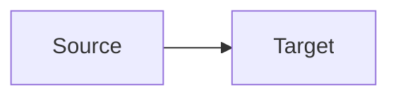

## Workflow

1. **Understand** the subject: read relevant documents to capture entities, relationships and flows accurately.
2. **Select** the diagram type (Diagram Selection Guide).
3. **Design** the structure: layout direction, groupings and abstraction level before writing syntax.
4. **Generate** valid Mermaid following the rules below.
5. **Embed** it in the target Markdown with a text description alongside, plus accessibility metadata (Accessibility section).
6. **Check syntax**: if `mmdc` (mermaid-cli) is available, render the diagram once to verify it parses; otherwise self-review against the Quality Checklist.

Per-type syntax and examples: [references/diagram-types.md](references/diagram-types.md)

## Diagram Selection Guide

| Use Case | Diagram Type |
|----------|-------------|
| Process flow, decision logic, algorithms | `flowchart` (LR or TB) |
| API calls, actor interactions over time | `sequenceDiagram` |
| Object-oriented structure, interfaces | `classDiagram` |
| Workflow states, status transitions | `stateDiagram-v2` |
| Database schema, entity relationships | `erDiagram` |
| Project timeline, sprint planning | `gantt` |
| Chronological events, product roadmaps | `timeline` |
| System architecture (high-level) | `C4Context` |
| System architecture (components) | `C4Container` / `C4Component` |
| Cloud infrastructure, deployment | `architecture` |
| Software modules, component layout | `block-beta` |
| Hierarchical idea organization | `mindmap` |
| Resource flow, value distribution | `sankey-beta` |
| 2D categorization, priority matrices | `quadrantChart` |
| Data distribution, proportions | `pie` |
| Git branching strategies | `gitGraph` |
| Task boards, workflow stages | `kanban` |
| Multi-variable comparison | `xychart-beta` |
| User experience mapping | `journey` |

For multi-level architecture, start with `C4Context` and drill into `C4Container`.

## Core Rules

- Configure with frontmatter (`---` YAML block), not `%%{init: ...}%%` directives. The Mermaid docs mark directives as deprecated in favour of frontmatter, which is available from v10.5.0 (https://mermaid.js.org/config/configuration.html).
- Use `%%` for comments; never use `{}` inside comments.
- Node IDs: alphanumeric, underscores, dashes only; no spaces or special characters (avoid `#`, `.`, `()`).
- Separate ID from label: `nodeId["Display Label with Spaces"]`. Quote labels with special characters; use entity codes such as `#35;` for a literal `#`.
- `end` is reserved: never use it as a bare node ID (`end_node["end"]`).
- Use `<br/>` for multi-line labels; keep labels short and move details to the surrounding text.
- Indent with 2 spaces.
- Flowchart direction: `TB` for hierarchies and dependency trees, `LR` for processes and pipelines, `BT` for layer stacks, `RL` rarely.
- Edges: `-->` solid, `---` open link, `-.->` dotted (secondary), `==>` thick (primary), `-->|label|` labelled.
- Group related nodes with `subgraph Name["Title"] ... end`; use `~~~` invisible links to nudge positioning.

### Complexity thresholds

- Nodes per diagram: under 25 for readability; split above 40.
- Connections: under 50; above 80 is unreadable.
- Subgraphs: max 5-6; nest sparingly.
- Node labels: max 4-5 words.
- Parallel branches: max 6-8 side by side.

When over the thresholds, split by abstraction level: an overview (C4 Context), one detail diagram per major component (C4 Container/Component), and sequence diagrams for specific flows.

## Accessibility

Always put a **text description** next to each diagram in the Markdown: screen readers cannot interpret Mermaid relationships.

Also add `accTitle` and `accDescr` inside the diagram. The Mermaid docs list them for all diagram types (https://mermaid.js.org/config/accessibility.html). They must come AFTER the diagram type keyword, never between the frontmatter closing `---` and the keyword, or the parser raises `UnknownDiagramError`:

```
---
config:
  theme: default
---
flowchart LR
  accTitle: My Title
  accDescr: My description
  A --> B
```

The docs do not document how every type handles them. If your target renderer rejects them in a given type (a parse error), drop them for that diagram and rely on the text description.

## Output Standards

- Diagrams embedded in an existing document: edit that document.
- Standalone diagram files: default to `docs/diagrams/<topic>.md`; use another location when the user or the project says so.
- Each diagram has a descriptive heading above it, the Mermaid block, and a text description below it.
- File names: lowercase kebab-case. Node IDs: lowercase with underscores (`api_gateway`). Subgraph titles: Title Case. Keep label casing consistent within a diagram.
- C4, architecture, block-beta, sankey-beta, xychart-beta and kanban may render inconsistently on GitHub; note that beside the diagram (see the reference for the current list).

Embedding pattern:

````markdown
## Section Title



**Description:** Source sends data to Target through an authenticated API call.
````

## Quality Checklist

- [ ] Diagram type matches the use case
- [ ] Node IDs valid (no reserved words, no special characters)
- [ ] Labels concise (4-5 words max)
- [ ] Complexity within thresholds (under 25 nodes, under 50 edges)
- [ ] Accessibility: see the Accessibility section (text description and metadata)
- [ ] Consistent styling (same edge types and shapes for the same concepts)
- [ ] Subgraphs used for groups of 3+ related nodes
- [ ] Direction matches the flow
- [ ] Per-type gotchas checked (Gantt, Pie, Mindmap: see the reference)
- [ ] Syntax verified (`mmdc` render, or self-review)

## What NOT to Do

- Do not exceed 40 nodes in one diagram; split it.
- Do not use `%%{init: ...}%%` directives; use frontmatter.
- Do not use `end` as a bare node ID or put special characters in node IDs.
- Do not use C4 or experimental diagram types without noting GitHub rendering limitations.
- Do not sacrifice readability for completeness; several simple diagrams beat one complex one.
