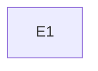

# Roadmap format contract (formatVersion 1)

The single contract for every file in a roadmap. `roadmap-planner` writes these files, `roadmap-tracker` edits them, and `roadmap-tracker/scripts/check-roadmap.mjs` enforces them. Skill text is English; the generated documents are written in the project's language. Anchors, IDs and the config are language-neutral; headers, prose and status words may be localized through `roadmap.config.json`.

## Contents

1. Folder layout
2. Config: `roadmap.config.json`
3. Anchors and tables
4. IDs and cell rules
5. Strategy document and deliverable card
6. State, decisions, log
7. Sources, requirements, critical path, measurements
8. README and the "when to update" table
9. What the checker enforces

## 1. Folder layout

Default root: `docs/plans/roadmap-<topic>/` (the user may override it).

```
<strategy>.md              versioned strategy; path set in config (default ../<date>-roadmap-<topic>.md; never end it in -plan.md, which plan-coordinator searches for implementation plans)
<root>/roadmap.config.json
<root>/check-roadmap.mjs   vendored copy of the checker; first line "// check-roadmap <version> format <n>"
<root>/README.md
<root>/state.md  decisions.md  log.md  critical-path.md  sources.md  requirements.md
<root>/measurements.md     optional; config "measurements": null when absent
```

File names may be localized; the config maps roles to names. One fact lives in one place: the strategy holds no state, `state.md` holds no history, `log.md` and `decisions.md` are append-only.

## 2. Config: `roadmap.config.json`

All keys are required; only `files.measurements` may be `null`.

```json
{
  "formatVersion": 1,
  "language": "en",
  "strategy": "../2026-01-01-roadmap-sample.md",
  "integrationBranch": "main",
  "files": { "readme": "README.md", "state": "state.md", "decisions": "decisions.md", "log": "log.md",
             "criticalPath": "critical-path.md", "measurements": null, "sources": "sources.md", "requirements": "requirements.md" },
  "vocab": {
    "deliverableStatuses": ["not-started", "spec", "plan", "executing", "on-branch", "integrated", "released", "measured"],
    "integratedStatuses": ["integrated", "released", "measured"],
    "decisionInForce": "in-force", "decisionPending": "pending", "decisionSupersededBy": "superseded by",
    "coverageCovered": "covered", "coverageOutOfScope": "out-of-scope", "coverageNeedsClarification": "needs-clarification",
    "branchLive": "live", "branchDeleted": "deleted",
    "markers": ["ASSUMPTION", "UNSOURCED"], "bannedPhrases": ["this commit"]
  },
  "tracks": ["engineering", "decisions", "external", "release", "measurement"],
  "limits": { "nowItems": 5, "cellChars": 300 }
}
```

- `strategy` and every `files` value are paths relative to the folder holding the config.
- `vocab` values are exact strings. Localize them freely (`"integrada"`, `"vigente"`, `"substituída por"`) and use the same words in the files. Comparison is exact and case-sensitive.
- `formatVersion` changes only with a migration recipe in `roadmap-tracker/references/events.md`. A checker older than the folder's `formatVersion` errors instead of guessing.
- `integratedStatuses` is the subset of statuses that claim code is on the integration branch.
- Card priority is not configurable: `Must`, `Should`, `Could`, `Won't`.

## 3. Anchors and tables

Machine-checked structure lives in HTML-comment anchors so the prose can be in any language:

```
<!-- roadmap:<name> key=value key="value with spaces" -->
...content...
<!-- /roadmap:<name> -->
```

Only `version` is a single comment with no closing: `<!-- roadmap:version 1.0 2026-01-01 -->` (version, date).

Tables inside a block are **position-mapped**: the checker ignores header text and reads columns by position, so headers may be localized. The first row is the header, the second the separator; both are dropped. Lists inside a block use `1.` or `-` at column 0; nested lines are continuation text.

| File | Block | Content (column order) |
|---|---|---|
| strategy | `version` | single comment: `1.0 2026-01-01` |
| strategy | `card` (attrs `id phase track priority size depends reqs critical`) | one per deliverable; wraps the card |
| strategy, inside a card | `acceptance` | ordered list; each top-level item is one criterion |
| strategy, inside a card | `risks` | list; each item "risk -> mitigation" |
| state | `now` | ordered list |
| state | `panel` | Deliverable, Status, Evidence, Next step |
| state | `blockers` | ID, Blocker, Affects, Since, Unblocks when |
| state | `pending` | list; each item "(owner) item" |
| state | `inflight` | Branch, Kind (`branchLive` / `branchDeleted` word), Note |
| decisions | `decisions` | ID, Date, Deliverable, Decision, Discarded alternative, Contradicts, Revisit when, Origin, Status |
| log | `log` | Date, Deliverable, What happened, Evidence |
| sources | `sources` | ID, Source (path or URL), What it is, Read on, Reliability |
| sources | `conflicts` | list; each item "SRC-a vs SRC-b: ..." |
| requirements | `requirements` | ID, Requirement, Type, Sources, Deliverables, Coverage |
| measurements | `measurements` | Date, Deliverable, Kind, Detail, Recorded, Billed, Status |

An empty table has its header and separator only. A literal `|` inside a cell is written `\|`. Every row must have exactly the column count in the table above (`bad-row` otherwise), because an unescaped `|` would shift the other columns silently. Text is compared after Unicode NFC normalization, so composed and decomposed accents match. CRLF and LF files are equivalent.

## 4. IDs and cell rules

- IDs: `E<n>` (deliverable), `REQ-NNN`, `SRC-NN`, `DEC-NNN`, `BLQ-n`. Never reused, never renumbered. The checker flags any cited ID without a definition (`unknown-id`) and any duplicate definition. Because IDs are never reused, `log.md` (append-only history) may cite a retired `BLQ-n` or a dropped `E<n>` without error; `REQ`, `SRC` and `DEC` citations in the log must still exist. IDs inside fenced code blocks are ignored, except ` ```mermaid ` blocks, which are checked.
- Status cell (panel): segments separated by `;`, each `[<label>:] <status>[ (note)]`, for example `piece 1: integrated; piece 2: spec (waiting on DEC-004)`. Notes must not contain `;` (nested balanced parentheses are fine). Every status must be in `vocab.deliverableStatuses`.
- Evidence: commit SHAs (7 to 40 hex digits), paths and URLs, each in backticks. A backticked SHA in the panel must exist (`sha-missing`, error). In `log.md` a missing SHA is only a warning: the append-only log may cite branch commits that vanish after a squash, a rebase or a fresh clone, and the row cannot be edited. A panel row with an `integratedStatuses` status must have at least one SHA (`integrated-no-sha`) and at least one of its SHAs must be an ancestor of the integration branch or of `origin/<integrationBranch>` (the other SHAs, for example a sibling piece still on a branch, only need to exist). In a shallow clone these git checks are skipped with one `shallow-clone` warning.
- Coverage cell: the `coverageCovered` word (and at least one deliverable in Deliverables), `coverageOutOfScope: <reason>` (reason required), or the `coverageNeedsClarification` word.
- Decision Status: `decisionInForce`, `decisionPending`, or `decisionSupersededBy DEC-NNN` (the target must exist).
- Contradicts cell: empty, `-` or `—` when the decision fits the roadmap; otherwise it names the section or deliverable it overrides. An in-force decision with a filled cell is *absorbed* once the strategy text cites its ID.
- Length: state and log cells at most `limits.cellChars`; `now` at most `limits.nowItems` items.
- Never write dates, durations, metrics or estimates that the user or a source did not supply. Unsourced claims carry `ASSUMPTION` or `UNSOURCED`; the checker reports their count in the strategy as a warning.

## 5. Strategy document and deliverable card

The strategy is versioned (v1.0, v1.1, ...), carries no state, and starts with the `version` anchor and a changelog. Sections, in this order, with headings in the project's language:

1. Changelog (newest first; each entry lists the `DEC` it absorbs)
2. Objective: acceptance criterion and definition of done
3. Non-goals
4. Assumptions: each with an owner and "re-validate when"; unverified claims tagged `ASSUMPTION`
5. Where we are (regenerated from `state.md` and `critical-path.md` at each revision)
6. Thesis
7. Deliverables overview (ID, title, phase, depends on)
8. Phases: in order, each with its name (by outcome), entry criteria, exit criteria and deliverables
9. Deliverable cards
10. Metrics and targets (sourced only; otherwise "none supplied")
11. Flags
12. Cross-cutting risks
13. Decisions: a pointer to `decisions.md`; cites a `DEC` only where it absorbs it
14. External pending items
15. Open questions
16. Coverage summary
17. Version history
18. Sources: a pointer to `sources.md`

Strategy skeleton (headings translated into the project's language):

```markdown
<!-- roadmap:version 1.0 <ISO date> -->
# <Topic> -- Strategy v1.0

## Changelog
- v1.0 (<ISO date>): first version.

## Objective
<objective>. Acceptance criterion: <testable>. Definition of done: <verifiable>.

## Non-goals
- <non-goal>

## Assumptions
| Assumption | Owner | Re-validate when |
|---|---|---|
| ASSUMPTION: <claim> | <owner> | <condition> |

## Where we are
<one paragraph from state.md>

## Thesis
<why this order>

## Deliverables overview
| ID | Title | Phase | Depends on |
|---|---|---|---|

## Phases
| Phase (outcome) | Entry criteria | Exit criteria | Deliverables |
|---|---|---|---|
| <outcome> | <what must be true to start> | <observable condition to finish> | E1 |

## Deliverables
<one card per deliverable, see below>

## Metrics and targets
None supplied.

## Flags
<feature flags or "none">

## Cross-cutting risks
- <risk> → <mitigation>

## Decisions
See decisions.md. (Cite a DEC only where this version absorbs it.)

## External pending items
- (<owner>) <item>

## Open questions
- <question>

## Coverage summary
<N covered, M out of scope, K to clarify>

## Version history
| Version | Date | Summary |
|---|---|---|
| 1.0 | <ISO date> | First version |

## Sources
See sources.md.
```

A deliverable ends at "gets its own spec and plan"; tasks are out of scope. Card template:

```markdown
<!-- roadmap:card id=E1 phase=<phase> track=engineering priority=Must size="not estimated" depends=- reqs=REQ-001 critical=true -->
### E1 -- Title

Why: REQ-001. One or two sentences of purpose.

Pieces (vertical slices, each shippable alone):

- Piece 1: ...
- Piece 2: ...

<!-- roadmap:acceptance -->
1. Given <context>, when <action>, then <observable result>.
2. Given <context>, when <action>, then <observable result>.
<!-- /roadmap:acceptance -->

Definition of done: <verifiable condition>.

<!-- roadmap:risks -->
- <risk> -> <mitigation>
<!-- /roadmap:risks -->
<!-- /roadmap:card -->
```

The template is the first card; for later cards change `id`, list earlier cards in `depends` and add the matching `REQ` ids. Card attrs: `depends` and `reqs` are comma lists or `-`; `critical` is `true` or `false`; `track` is one of `tracks`; `priority` is MoSCoW; `size` is a range with its basis, or `"not estimated"`. At least one `REQ`, at least two acceptance items, one panel row per card. A critical card needs at least one risk (warning). Specs and plans are not in the card; the panel points to them.

## 6. State, decisions, log

`state.md` is overwritten on every update: a header line with the strategy version and date, then `now` (at most five items), `panel`, `blockers`, `pending` and `inflight`. Template:

```markdown
<!-- roadmap:now -->
1. <next action>
<!-- /roadmap:now -->
<!-- roadmap:panel -->
| Deliverable | Status | Evidence | Next step |
|---|---|---|---|
| E1 | not-started | - | <step> |
<!-- /roadmap:panel -->
<!-- roadmap:blockers -->
| ID | Blocker | Affects | Since | Unblocks when |
|---|---|---|---|---|
<!-- /roadmap:blockers -->
<!-- roadmap:pending -->
- (owner) <item>
<!-- /roadmap:pending -->
<!-- roadmap:inflight -->
| Branch | Kind | Note |
|---|---|---|
<!-- /roadmap:inflight -->
```

`decisions.md` is append-only, global IDs, never reused. Rows are never edited except Status (to `superseded by DEC-NNN`) and Revisit when. One row per choice: the decision, the discarded alternative, who or what originated it (`SRC`, `REQ` or "user"). Template:

```markdown
# Decisions

<!-- roadmap:decisions -->
| ID | Date | Deliverable | Decision | Discarded alternative | Contradicts | Revisit when | Origin | Status |
|---|---|---|---|---|---|---|---|---|
| DEC-001 | <ISO date> | E1 | <what was decided> | <what was not chosen> | - | <condition> | user | in-force |
<!-- /roadmap:decisions -->
```

`log.md` is append-only, newest first (ISO dates, descending). Each row: date, deliverable (`E<n>` or `-`), what happened in at most `cellChars` characters, evidence (SHA, path or URL in backticks, never empty). Never write "this commit". Template:

```markdown
# Log

<!-- roadmap:log -->
| Date | Deliverable | What happened | Evidence |
|---|---|---|---|
| <ISO date> | - | Roadmap created | `<strategy file>` |
<!-- /roadmap:log -->
```

## 7. Sources, requirements, critical path, measurements

`sources.md`: one `SRC-NN` row per source read (path or URL, what it is, date read, reliability note); conflicts between sources go in the `conflicts` block and are never resolved silently.

`requirements.md`: one `REQ-NNN` row per requirement, traced to `SRC`/`DEC`, with Deliverables and Coverage. Requirement and card must agree: if a requirement lists `E2`, the `E2` card lists the requirement (warning `req-card-asymmetry` otherwise).

`critical-path.md`: a Mermaid graph of deliverables and gates plus the next gate per track. Gates may appear as nodes: blockers (`BLQ-n`, defined in `state.md`) and decision gates (`DEC-NNN`, defined in `decisions.md`). Write a gate node with a hyphen-free node id and the real ID in its label (`BLQ1["BLQ-1: <gate>"]`), because the checker reads IDs in Mermaid labels and every cited ID must exist. Ordering only; no dates unless the user supplied them. The checker only verifies that the IDs cited exist.

`measurements.md` (optional): runs, costs and measurement milestones. Recorded and Billed are separate columns.

Templates:

```markdown
<!-- roadmap:sources -->
| ID | Source | What it is | Read on | Reliability |
|---|---|---|---|---|
| SRC-01 | `<path or URL>` | <what it is> | <ISO date> | <note> |
| SRC-02 | `<path or URL>` | <what it is> | <ISO date> | <note> |
<!-- /roadmap:sources -->

## Conflicts

<!-- roadmap:conflicts -->
- SRC-01 vs SRC-02: <what disagrees>
<!-- /roadmap:conflicts -->
```

```markdown
<!-- roadmap:requirements -->
| ID | Requirement | Type | Sources | Deliverables | Coverage |
|---|---|---|---|---|---|
| REQ-001 | <statement> | functional | SRC-01 | E1 | covered |
| REQ-002 | <statement> | functional | SRC-01 | - | out-of-scope: <reason> |
<!-- /roadmap:requirements -->
```

````markdown
# Critical path



Critical path: E1. Next gate per track: <gate>.
````

```markdown
<!-- roadmap:measurements -->
| Date | Deliverable | Kind | Detail | Recorded | Billed | Status |
|---|---|---|---|---|---|---|
| <ISO date> | E1 | run | <detail> | <value> | <value> | <status> |
<!-- /roadmap:measurements -->
```

## 8. README and the "when to update" table

The generated `README.md` must state the check command, `node <roadmap-folder>/check-roadmap.mjs` (Node 18 or newer; exits 1 on errors, warnings pass), list the files and their nature, and include this table:

| Event | Update |
|---|---|
| A decision is made | `decisions.md` first, then whatever uses it |
| A piece or step closes | `log.md` and the panel in `state.md` |
| A branch is integrated or deleted | "in flight" in `state.md` and `log.md` |
| A paid run or measurement | `measurements.md` and `log.md` |
| A blocker opens or closes | `state.md` and `critical-path.md` |
| A piece or phase ends | propose a strategy revision |

The "paid run or measurement" row is dropped when `files.measurements` is `null`. README template:

```markdown
# <Topic> roadmap -- tracking folder

Living tracking for the roadmap. Strategy: `<strategy file>`.

## Files
| File | Nature |
|---|---|
| `state.md` | Overwritten snapshot: Now, panel, blockers, pending, in flight |
| `decisions.md` | Append-only decisions |
| `log.md` | Append-only events, newest first |
| `critical-path.md` | Dependency graph and next gates |
| `sources.md` | Source inventory and conflicts |
| `requirements.md` | Requirements and their coverage |
| `roadmap.config.json` | Paths, vocabulary, limits |

## Check
Run `node <roadmap-folder>/check-roadmap.mjs` (Node 18 or newer). Exit 1 on errors; warnings pass.

## When to update
<the table above>
```

## 9. What the checker enforces

Errors: `format-version`, `unknown-id`, `duplicate-id`, `bad-status`, `now-limit`, `cell-limit`, `log-order`, `banned-phrase`, `missing-evidence`, `uncovered-req`, `card-no-req`, `card-acceptance`, `card-no-panel-row`, `panel-unknown-deliverable`, `dependency-cycle`, `superseded-link`, `unknown-track`, `bad-priority`, `missing-block`, `unclosed-block`, `bad-row`, `integrated-no-sha`, and with git: `sha-missing`, `not-integrated`, `branch-live-missing`, `branch-deleted-exists`. A `sha-missing` found in `log.md` is a warning, not an error.

Warnings: `contradiction-unabsorbed`, `needs-clarification`, `critical-no-risk`, `markers`, `req-card-asymmetry`, `no-git`, `shallow-clone`, `integration-branch-missing`, `checker-stale`.

The `integration-branch-missing` warning appears only when a panel row claims an integrated status with commit evidence and neither `<integrationBranch>` nor `origin/<integrationBranch>` exists.
