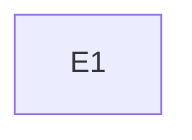

# Roadmap format contract (formatVersion 1)

The single contract for every file in a roadmap. `roadmap-planner` writes these files, `roadmap-tracker` edits them, and `roadmap-tracker/scripts/check-roadmap.mjs` enforces them. Skill text is English; the generated documents are written in the project's language. Anchors, IDs and the config are language-neutral; headers, prose and status words may be localized through `roadmap.config.json`.

## Contents

1. Folder layout
2. Config: `roadmap.config.json`
3. Anchors and tables
4. IDs and cell rules
5. Strategy document and deliverable card
6. State, decisions, log
7. Sources, requirements, critical path, measurements
8. README and the "when to update" table
9. What the checker enforces

## 1. Folder layout

Default root: `docs/plans/roadmap-<topic>/` (the user may override it).

```
<strategy>.md              versioned strategy; path set in config (default ../<date>-roadmap-<topic>.md; never end it in -plan.md, which plan-coordinator searches for implementation plans; the checker warns `strategy-plan-suffix` when it does)
<root>/roadmap.config.json
<root>/check-roadmap.mjs   vendored copy of the checker; first line "// check-roadmap <version> format <n>"
<root>/README.md
<root>/state.md  decisions.md  log.md  critical-path.md  sources.md  requirements.md
<root>/measurements.md     optional; config "measurements": null when absent
<root>/planning-model.json  temporary, planner only: the planning model (model.md of roadmap-planner); deleted at the end of Step 7; the checker ignores it
```

File names may be localized; the config maps roles to names. One fact lives in one place: the strategy holds no state, `state.md` holds no history, `log.md` and `decisions.md` are append-only.

## 2. Config: `roadmap.config.json`

All keys are required except the optional `vocab.releasedStatuses`, `vocab.blockedStatus`, `vocab.discardedStatus`, `releaseBranch` and `limits.pendingItems` (a new roadmap sets the first three and `limits.pendingItems`, and sets `releaseBranch` only when the project merges through an intermediate branch); only `files.measurements` may be `null`.

```json
{
  "formatVersion": 1,
  "language": "en",
  "strategy": "../2026-01-01-roadmap-sample.md",
  "integrationBranch": "main",
  "releaseBranch": "release/2026-01",
  "files": { "readme": "README.md", "state": "state.md", "decisions": "decisions.md", "log": "log.md",
             "criticalPath": "critical-path.md", "measurements": null, "sources": "sources.md", "requirements": "requirements.md" },
  "vocab": {
    "deliverableStatuses": ["not-started", "spec", "plan", "executing", "on-branch", "integrated", "released", "measured", "blocked", "discarded"],
    "integratedStatuses": ["integrated", "released", "measured"],
    "releasedStatuses": ["released", "measured"],
    "blockedStatus": "blocked", "discardedStatus": "discarded",
    "decisionInForce": "in-force", "decisionPending": "pending", "decisionSupersededBy": "superseded by",
    "coverageCovered": "covered", "coverageOutOfScope": "out-of-scope", "coverageNeedsClarification": "needs-clarification",
    "branchLive": "live", "branchDeleted": "deleted",
    "markers": ["ASSUMPTION", "UNSOURCED"], "bannedPhrases": ["this commit"]
  },
  "tracks": ["engineering", "decisions", "external", "release", "measurement"],
  "limits": { "nowItems": 5, "cellChars": 300, "pendingItems": 20 }
}
```

- `strategy` and every `files` value are paths relative to the folder holding the config.
- `vocab` values are exact strings. Localize them freely (`"integrada"`, `"vigente"`, `"substituída por"`) and use the same words in the files. Comparison is exact and case-sensitive.
- `formatVersion` changes only with a migration recipe in `roadmap-tracker/references/events/11-migration.md`. A checker older than the folder's `formatVersion` errors instead of guessing.
- `deliverableStatuses` is positional: its entries keep the canonical order of the default list above (1 not-started, 2 spec, 3 plan, 4 executing, 5 on-branch, 6 integrated, 7 released, 8 measured, then the `blockedStatus` and `discardedStatus` words). A localized roadmap replaces the words but keeps the order, so the Nth word always means the Nth canonical status. The order is checked by the warning `status-order` (fewer than 8 words, or an integrated, released, blocked or discarded word outside its canonical position); the planner writes it and the tracker relies on it.
- `releaseBranch` (optional): a non-empty string naming the intermediate branch where deliverables merge before `integrationBranch`. The checker only validates the value (an empty or non-string value is an `ERROR config`); it does not check that the branch exists. Convention for a merge into it: section 6.
- `limits.pendingItems` (optional; a new roadmap sets 20): maximum items in the `pending` block. When present, a longer block gives the warning `pending-limit`; when absent nothing is checked. Like every `limits` value it must be a positive number.
- `integratedStatuses` is the subset of statuses that claim code is on the integration branch.
- `releasedStatuses` (optional; default `["released", "measured"]` when absent) is the subset of statuses that claim a deliverable shipped in a package; it matters only when `state.md` has a `releases` block (section 6).
- `blockedStatus` and `discardedStatus` (optional; defaults `"blocked"` and `"discarded"`) are the localized words the tracker writes for those two states. When present, each must be a non-empty string contained in `deliverableStatuses`. A folder created before 1.3.0 adds the word to `deliverableStatuses` and these keys before first use.
- `releasedStatuses` and `integratedStatuses`, when present, must only contain elements of `deliverableStatuses`. When `releasedStatuses` is absent and neither default (`released`, `measured`) is in `deliverableStatuses`, the checker warns `vocab-default-missing` (only if a `releases` block exists): the released-package check is then inactive, so set `releasedStatuses` to the localized words.
- Two statuses beyond the delivery line: `blocked` (a `blocked` segment should cite a `BLQ-n` in its note or in Next step) and `discarded` (dropped by a `DEC`; the card is kept, with priority `Won't`). Older format-1 folders that lack them in `deliverableStatuses` keep working; add them to use them.
- Card priority is not configurable: `Must`, `Should`, `Could`, `Won't`.
- The checker validates the config before reading anything else, and reports `ERROR config: <key> ...` (exit 1) when: `formatVersion` is not an integer >= 1; any vocab string or array element, or any `tracks` element, is empty or not a string; `deliverableStatuses` or `tracks` is empty; a `limits` value is not a positive number (the string `"5"` is rejected); a `files` value (or `strategy`) is absolute or escapes its allowed root (`files` stay inside the roadmap folder; `strategy` may be `../<file>` but must stay inside the git top level when git resolves it, or inside the folder's parent when there is no git); `releaseBranch` is present but empty or not a string; a `releasedStatuses`, `integratedStatuses`, `blockedStatus` or `discardedStatus` value is not in `deliverableStatuses`; two roles (including `strategy`) point to the same file.

## 3. Anchors and tables

Machine-checked structure lives in HTML-comment anchors so the prose can be in any language:

```
<!-- roadmap:<name> key=value key="value with spaces" -->
...content...
<!-- /roadmap:<name> -->
```

Only `version` is a single comment with no closing: `<!-- roadmap:version 1.0 2026-01-01 -->` (version, date).

Tables inside a block are **position-mapped**: the checker ignores header text and reads columns by position, so headers may be localized. The first row is the header, the second the separator; both are dropped. Lists inside a block use `1.` or `-` at column 0; nested lines are continuation text.

| File | Block | Content (column order) |
|---|---|---|
| strategy | `version` | single comment: `1.0 2026-01-01` |
| strategy | `card` (attrs `id phase track priority size depends reqs critical`) | one per deliverable; wraps the card |
| strategy, inside a card | `acceptance` | ordered list; each top-level item is one criterion, optionally ending in a verification tag (section 5) |
| strategy, inside a card | `risks` | list; each item "risk -> mitigation" |
| strategy (optional) | `phases` | Phase, Entry criteria, Exit criteria, Deliverables |
| strategy (optional) | `gates` | ID, Command, Environment, When, Baseline |
| state | `now` | ordered list |
| state | `panel` | Deliverable, Status, Evidence, Next step |
| state | `blockers` | ID, Blocker, Affects, Since, Unblocks when |
| state | `pending` | list; each item "(owner) item" |
| state | `inflight` | Branch, Kind (`branchLive` / `branchDeleted` word), Note |
| state | `donot` (optional) | list "Do not do now"; each item cites at least one `BLQ-n` or `DEC-NNN` |
| state | `releases` (optional) | Package, Deliverables, State, Stamped SHA, Date, Environment |
| decisions | `decisions` | ID, Date, Deliverable, Decision, Discarded alternative, Contradicts, Revisit when, Origin, Status |
| log | `log` | Date, Deliverable, What happened, Evidence |
| sources | `sources` | ID, Source (path or URL), What it is, Read on, Reliability |
| sources | `conflicts` | list; each item "SRC-a vs SRC-b: ..." |
| requirements | `requirements` | ID, Requirement, Type, Sources, Deliverables, Coverage |
| measurements | `measurements` | Date, Deliverable, Kind, Detail, Recorded, Billed, Status |

Anchors inside fenced code blocks (any fence, including ` ```mermaid `) are ignored by the block scan, so a template can be quoted in a fence without defining a block; an unclosed fence is a warning (`unclosed-fence`) and hides the rest of the file from the scan. An opener whose `-->` is missing before the next `<!--` is an error (`malformed-anchor`) naming the block.

An empty table has its header and separator only. A literal `|` inside a cell is written `\|`. Every row must have exactly the column count in the table above (`bad-row` otherwise), because an unescaped `|` would shift the other columns silently. Text is compared after Unicode NFC normalization, so composed and decomposed accents match. CRLF and LF files are equivalent.

## 4. IDs and cell rules

- IDs: `E<n>` (deliverable), `REQ-NNN`, `SRC-NN`, `DEC-NNN`, `BLQ-n`. Never reused, never renumbered. The checker flags any cited ID without a definition (`unknown-id`) and any duplicate definition. Because IDs are never reused, `log.md` (append-only history) may cite a retired `BLQ-n` or a dropped `E<n>` without error; `decisions.md` is append-only too and gets the same allowance. The strategy may also keep citing a retired `BLQ-n` (for example in "Where we are" or an Open questions entry) until the next approved revision, because closing a blocker removes its row but the strategy changes only through a revision; it may not cite a dropped `E<n>`. `REQ`, `SRC` and `DEC` citations in all three must still exist. IDs inside fenced code blocks are ignored, except ` ```mermaid ` blocks, which are checked.
- Status cell (panel): segments separated by `;`, each `[<label>:] <status>[ (note)]`, for example `piece 1: integrated; piece 2: spec (waiting on DEC-004)`. Notes must not contain `;` (nested balanced parentheses are fine). Every status must be in `vocab.deliverableStatuses`.
- Evidence: commit SHAs (7 to 40 hex digits), paths and URLs, each in backticks. A backticked SHA in the panel must exist (`sha-missing`, error). In `log.md` a missing SHA is only a warning: the append-only log may cite branch commits that vanish after a squash, a rebase or a fresh clone, and the row cannot be edited. A panel row with an `integratedStatuses` status must have at least one SHA (`integrated-no-sha`) and at least one of its SHAs must be an ancestor of the integration branch or of `origin/<integrationBranch>` (the other SHAs, for example a sibling piece still on a branch, only need to exist). The opposite lag is a warning: a row whose every status segment is the on-branch word (`deliverableStatuses[4]`, the fifth canonical status), with at least one existing SHA where every existing SHA is an ancestor of the integration branch or of `origin/<integrationBranch>`, gives `integrated-pending` (the code is already integrated, so the status should move on). A row with any other segment, for example `code: on-branch; acceptance: blocked (BLQ-2)`, never triggers it. In a shallow clone these git checks are skipped with one `shallow-clone` warning.
- Coverage cell: the `coverageCovered` word (and at least one deliverable in Deliverables), `coverageOutOfScope: <reason>` (reason required), or the `coverageNeedsClarification` word.
- Decision Status: `decisionInForce`, `decisionPending`, or `decisionSupersededBy DEC-NNN` (the target must exist).
- Contradicts cell: empty, `-` or `—` when the decision fits the roadmap; otherwise it names the section or deliverable it overrides. An in-force decision with a filled cell is *absorbed* once the strategy text cites its ID as a whole token (`DEC-001` is not absorbed by a citation of `DEC-0010`). The same `-` / `—` (meaning "none") is allowed in Discarded alternative and Revisit when.
- Volatile values: a value that changes over time (counts, balances, quotas) is written once, together with the command that measures it and the date, and every other file points to that place instead of repeating the number.
- Inflight Kind must be the `branchLive` or `branchDeleted` word (`bad-kind` otherwise).
- Encoding: files must be UTF-8; invalid bytes produce a warning (`invalid-utf8`) and are replaced while reading.
- Length: state and log cells at most `limits.cellChars`; `now` at most `limits.nowItems` items. `decisions.md` is append-only, so a long cell there is never an error: one aggregated warning `decisions-cell-long` counts the rows with a cell above `limits.cellChars` and names the first few IDs.
- Panel Evidence holds references only (SHAs, gate IDs, paths); counts and lists of resolved items belong in `log.md`.
- Never write dates, durations, metrics or estimates that the user or a source did not supply. Unsourced claims carry `ASSUMPTION` or `UNSOURCED`; the checker reports their count in the strategy as a warning.

## 5. Strategy document and deliverable card

The strategy is versioned (v1.0, v1.1, ...), carries no state, and starts with the `version` anchor and a changelog. Sections, in this order, with headings in the project's language:

1. Changelog (newest first; each entry lists the `DEC` it absorbs)
2. Objective: acceptance criterion and definition of done
3. Non-goals
4. Assumptions: each with an owner and "re-validate when"; unverified claims tagged `ASSUMPTION`
5. Where we are (regenerated from `state.md` and `critical-path.md` at each revision)
6. Thesis
7. Deliverables overview (ID, title, phase, depends on)
8. Phases: in order, each with its name (by outcome), entry criteria, exit criteria and deliverables
9. Deliverable cards
10. Gates and verification: the `gates` table (below), written when there are gates (none in `CLAUDE.md` or the sources: omitted, and the handoff says so)
11. Metrics and targets (sourced only; otherwise "none supplied"); may be omitted when empty
12. Flags; may be omitted when empty
13. Cross-cutting risks
14. Decisions: a pointer to `decisions.md`; cites a `DEC` only where it absorbs it
15. External pending items
16. Open questions
17. Coverage summary
18. Version history
19. Sources: a pointer to `sources.md`

Rules checked as warnings: the `Definition of done` of a card that has at least one executable acceptance criterion cites a gate ID from the `gates` table, outside the `acceptance` and `risks` blocks (`dod-no-gate`). The phases table is adopted by wrapping it in the `phases` block; only then do `card-phase-table` (every card in exactly one row, one phase per row, distinct phases across rows) and `phase-order` (a card never depends on one whose row comes later) run.

Strategy skeleton (headings translated into the project's language):

```markdown
<!-- roadmap:version 1.0 <ISO date> -->
# <Topic> -- Strategy v1.0

## Changelog
- v1.0 (<ISO date>): first version (<full|light> mode).

## Objective
<objective>. Acceptance criterion: <testable>. Definition of done: <verifiable>.

## Non-goals
- <non-goal>

## Assumptions
| Assumption | Owner | Re-validate when |
|---|---|---|
| ASSUMPTION: <claim> | <owner> | <condition> |

## Where we are
<one paragraph from state.md>

## Thesis
<why this order>

## Deliverables overview
| ID | Title | Phase | Depends on |
|---|---|---|---|

## Phases
<!-- roadmap:phases -->
| Phase (outcome) | Entry criteria | Exit criteria | Deliverables |
|---|---|---|---|
| <outcome> | <what must be true to start> | <observable condition to finish> | E1 |
<!-- /roadmap:phases -->

## Deliverables
<one card per deliverable, see below>

## Gates and verification
<!-- roadmap:gates -->
| ID | Command | Environment | When | Baseline |
|---|---|---|---|---|
| G1 | `<exact command, copied from the project CLAUDE.md or a source>` | <local, staging or prod> | <every task, before merge, ...> | <expected result today> |
<!-- /roadmap:gates -->

## Metrics and targets
None supplied. (Omit this section and Flags when empty.)

## Flags
<feature flags or "none">

## Cross-cutting risks
- <risk> → <mitigation>

## Decisions
See decisions.md. (Cite a DEC only where this version absorbs it.)

## External pending items
- (<owner>) <item>

## Open questions
- <question>
- E<n>: <deliverable-level question, for superpowers:brainstorming>

## Coverage summary
<N covered, M out of scope, K to clarify>

## Version history
| Version | Date | Summary |
|---|---|---|
| 1.0 | <ISO date> | First version |

## Sources
See sources.md.
```

A deliverable ends at "gets its own spec and plan"; tasks are out of scope. Card template:

```markdown
<!-- roadmap:card id=E1 phase=<phase> track=engineering priority=Must size="not estimated" depends=- reqs=REQ-001 critical=true -->
### E1 -- Title

Why: REQ-001. One or two sentences of purpose.

Pieces (vertical slices, each shippable alone):

- Piece 1: ...
- Piece 2: ...

<!-- roadmap:acceptance -->
1. Given <context>, when <action>, then <observable result>. {verify: test; evidence: <exact command>}
2. Given <context>, when <action>, then <observable result>. {verify: human; evidence: <who confirms, and where>}
<!-- /roadmap:acceptance -->

Definition of done: <verifiable condition; cite the gate IDs that must be green, e.g. G1, G2>.

<!-- roadmap:risks -->
- <risk> -> <mitigation>
<!-- /roadmap:risks -->
<!-- /roadmap:card -->
```

The template is the first card; for later cards change `id`, list earlier cards in `depends` and add the matching `REQ` ids. Card attrs: `depends` and `reqs` are comma lists or `-`; `critical` is `true` or `false`; `track` is one of `tracks`; `priority` is MoSCoW; `size` is a range with its basis, or `"not estimated"`. At least one `REQ`, at least two acceptance items, one panel row per card. A critical card needs at least one risk (warning). Specs and plans are not in the card; the panel points to them.

**Acceptance verification tag.** An acceptance item may end with ` {verify: <kind>[ BLQ-n]; evidence: <command or artifact>}`. Kinds: `test`, `smoke`, `integration` (evidence is an exact command that exits 0 only if the criterion holds), `human` (evidence names who confirms and where) and `blocked` (must cite a `BLQ-n`, for example `{verify: blocked BLQ-2; evidence: waits for the vendor key}`). The tag is stripped when reading an item, so it never changes the item count. Two warnings: `ac-verify-invalid` (unknown kind, `blocked` without a `BLQ-n`, empty evidence on `test`, `smoke` or `integration`, `BLQ-n` on a kind other than `blocked`, or a tag that is not closed, with no closing brace) and `ac-verify-missing` (one per card with untagged items). `ac-verify-missing` follows an adoption rule: it fires only when at least one acceptance item anywhere in the strategy carries a tag, so roadmaps written before 1.5.0 stay quiet until they adopt tags. A new roadmap tags every item. For code not yet written, see decompose.md § 10 for how to derive the evidence command from the gates.

**Gates and verification.** The optional `gates` block (5 columns: ID, Command, Environment, When, Baseline; rows follow the normal `bad-row` rule) records the commands that prove a change is good. When it has gates it writes the block, copying the commands from the project `CLAUDE.md` and the sources; a card Definition of done cites gate IDs (`G1`). A row with an empty, `-` or `—` Command gives the warning `gate-no-command`. The section sits right after the cards.

## 6. State, decisions, log

`state.md` is overwritten on every update: a header line with the strategy version and date (checked: `state-header` warns when the text before the first anchor lacks `v<version>`), then `now` (at most five items), `panel`, `blockers`, `pending` and `inflight`, plus the optional `donot` and `releases` blocks. Conventions (not checked unless noted): code ready with acceptance pending is written as panel segments, `code: on-branch; acceptance: blocked (BLQ-2)`; a merge into `releaseBranch` sets the on-branch word, cites the merge SHA in Evidence and names the branch in Next step; the `pending` block holds at most `limits.pendingItems` items. Shape of a `now` item (guidance, not checked): `<action>. Runs: <who>. Approves: <who>. Depends on: <ids>.` Template:

```markdown
Strategy v<version> -- <ISO date>

<!-- roadmap:now -->
1. <next action>
<!-- /roadmap:now -->
<!-- roadmap:panel -->
| Deliverable | Status | Evidence | Next step |
|---|---|---|---|
| E1 | not-started | - | <step> |
<!-- /roadmap:panel -->
<!-- roadmap:blockers -->
| ID | Blocker | Affects | Since | Unblocks when |
|---|---|---|---|---|
| BLQ-1 | <blocker> | E1 | <ISO date> | <condition>; restores E1 to <previous status> |
<!-- /roadmap:blockers -->
<!-- roadmap:pending -->
- (owner) <item>
<!-- /roadmap:pending -->
<!-- roadmap:inflight -->
| Branch | Kind | Note |
|---|---|---|
<!-- /roadmap:inflight -->
```

Optional blocks of `state.md`; when absent the checker reports nothing:

```markdown
<!-- roadmap:donot -->
- Do not <action> until <BLQ-n> clears.
- Do not <action> (<DEC-NNN>).
<!-- /roadmap:donot -->
<!-- roadmap:releases -->
| Package | Deliverables | State | Stamped SHA | Date | Environment |
|---|---|---|---|---|---|
| <package id> | E1 E2 | <shipped, pending install, ...> | `<sha>` | <ISO date> | <environment> |
<!-- /roadmap:releases -->
```

- `pending`: each item starts with an owner in parentheses, `(owner) item` (`pending-no-owner`).
- `panel`: a segment whose status is the blocked word cites a `BLQ-n` in its note or in the Next step column (`blocked-no-blq`).
- `blockers`: for each deliverable in Affects that is blocked in the panel, "Unblocks when" names `E<n>` followed by a status word other than the blocked one, such as "restores E<n> to <status>" (`blocker-no-restore`). An "Unblocks when" cell may carry `(due YYYY-MM-DD)`; once that date is before today the warning `blocker-overdue` appears (the checker takes today from the system clock). When a deliverable is set to the blocked status, "Unblocks when" ends with "restores E<n> to <previous status>" (the status before it was blocked; a deliverable created blocked restores to the first `deliverableStatuses` word). Closing the blocker reads it back (`events.md` § 5).
- `donot` ("Do not do now"): a list; each item cites at least one `BLQ-n` or `DEC-NNN` (`donot-no-ref` otherwise). Cited IDs must exist (`unknown-id`).
- `releases`: when the block exists, every panel row with a segment status in `vocab.releasedStatuses` must appear in the Deliverables cell of some row (`released-no-package`). A backticked Stamped SHA follows the panel SHA rules (it must exist: `sha-missing`, error). Cell length limits apply as in the rest of `state.md`.

`decisions.md` is append-only, global IDs, never reused. Rows are never edited except Status (to `superseded by DEC-NNN`) and Revisit when. One row per choice: the decision, the discarded alternative, who or what originated it (`SRC`, `REQ`, "user" or `executor`). A decision taken by an executor (Origin `executor`) has the `decisionPending` word as Status until the owner ratifies it. Its Decision cell ends with `Alcance: local.` / `Scope: local.` or `Alcance: contrato.` / `Scope: contract.` (absent means contract). A pending contract decision warns `executor-decision-pending` when a card that depends on its deliverable is already past `not-started` and before `released`; any pending decision warns when its deliverable is already released. A decision that diverges from an existing `DEC`, or that changes a gate, fills Contradicts where it applies and is never taken by the executor alone: it stays pending for the owner. Template:

```markdown
# Decisions

<!-- roadmap:decisions -->
| ID | Date | Deliverable | Decision | Discarded alternative | Contradicts | Revisit when | Origin | Status |
|---|---|---|---|---|---|---|---|---|
| DEC-001 | <ISO date> | E1 | <what was decided> | <what was not chosen> | - | <condition> | user | in-force |
<!-- /roadmap:decisions -->
```

`log.md` is append-only, newest first (ISO dates, descending). Each row: date, deliverable (`E<n>` or `-`), what happened in at most `cellChars` characters, evidence (SHA, path or URL in backticks, never empty). Never write "this commit". Template:

```markdown
# Log

<!-- roadmap:log -->
| Date | Deliverable | What happened | Evidence |
|---|---|---|---|
| <ISO date> | - | Roadmap created | `<strategy file>` |
<!-- /roadmap:log -->
```

## 7. Sources, requirements, critical path, measurements

`sources.md`: one `SRC-NN` row per source read (path or URL, what it is, date read, reliability note); conflicts between sources go in the `conflicts` block and are never resolved silently.

`requirements.md`: one `REQ-NNN` row per requirement, traced to `SRC`/`DEC`, with Deliverables and Coverage. Requirement and card must agree: if a requirement lists `E2`, the `E2` card lists the requirement (warning `req-card-asymmetry` otherwise).

`critical-path.md`: a Mermaid graph of deliverables and gates plus the next gate per track; that line points to `state.md` instead of restating state. Gates may appear as nodes: blockers (`BLQ-n`, defined in `state.md`) and decision gates (`DEC-NNN`, defined in `decisions.md`). Write a gate node with a hyphen-free node id and the real ID in its label (`BLQ1["BLQ-1: <gate>"]`), because the checker reads IDs in Mermaid labels and every cited ID must exist. Ordering only; no dates unless the user supplied them. The checker only verifies that the IDs cited exist.

`measurements.md` (optional): runs, costs and measurement milestones. Recorded and Billed are separate columns.

Templates:

```markdown
<!-- roadmap:sources -->
| ID | Source | What it is | Read on | Reliability |
|---|---|---|---|---|
| SRC-01 | `<path or URL>` | <what it is> | <ISO date> | <note> |
| SRC-02 | `<path or URL>` | <what it is> | <ISO date> | <note> |
<!-- /roadmap:sources -->

## Conflicts

<!-- roadmap:conflicts -->
- SRC-01 vs SRC-02: <what disagrees>
<!-- /roadmap:conflicts -->
```

```markdown
<!-- roadmap:requirements -->
| ID | Requirement | Type | Sources | Deliverables | Coverage |
|---|---|---|---|---|---|
| REQ-001 | <statement> | functional | SRC-01 | E1 | covered |
| REQ-002 | <statement> | functional | SRC-01 | - | out-of-scope: <reason> |
<!-- /roadmap:requirements -->
```

````markdown
# Critical path



Critical path: E1. Next gate per track: <gate>.
````

```markdown
<!-- roadmap:measurements -->
| Date | Deliverable | Kind | Detail | Recorded | Billed | Status |
|---|---|---|---|---|---|---|
| <ISO date> | E1 | run | <detail> | <value> | <value> | <status> |
<!-- /roadmap:measurements -->
```

## 8. README and the "when to update" table

The generated `README.md` must state the check command, `node <roadmap-folder>/check-roadmap.mjs` (Node 18 or newer; exits 1 on errors, warnings pass), list the files and their nature, and include this table:

| Event | Update |
|---|---|
| A decision is made | `decisions.md` first, then whatever uses it |
| A piece or step closes | `log.md` and the panel in `state.md` |
| A branch is integrated or deleted | "in flight" in `state.md` and `log.md` |
| A paid run or measurement | `measurements.md` and `log.md` |
| A blocker opens or closes | `state.md` and `critical-path.md` |
| A package is published | the `releases` block in `state.md` (only if the folder has one), and `log.md` |
| The "do not do now" list changes | the `donot` block in `state.md` (only if the folder has one) |
| A piece or phase ends | propose a strategy revision |

The "paid run or measurement" row is dropped when `files.measurements` is `null`; the "package is published" and "do not do now" rows are dropped when `state.md` has no `releases` / `donot` block. README template:

```markdown
# <Topic> roadmap -- tracking folder

Living tracking for the roadmap. Strategy: `<strategy file>`.

## Files
| File | Nature |
|---|---|
| `state.md` | Overwritten snapshot: Now, panel, blockers, pending, in flight |
| `decisions.md` | Append-only decisions |
| `log.md` | Append-only events, newest first |
| `critical-path.md` | Dependency graph and next gates |
| `sources.md` | Source inventory and conflicts |
| `requirements.md` | Requirements and their coverage |
| `roadmap.config.json` | Paths, vocabulary, limits |

## Check
Run `node <roadmap-folder>/check-roadmap.mjs` (Node 18 or newer). Exit 1 on errors; warnings pass; exit 2 is an unexpected failure (`ERROR internal`). In CI add `--require-git` so that skipped git checks fail instead of passing silently.

## When to update
<the table above>
```

## 9. What the checker enforces

Run `node check-roadmap.mjs [folder] [--require-git] [--json]`. Exit 0: no errors (warnings pass). Exit 1: at least one error, or an `ERROR config:` / `bad-header` failure. Exit 2: an unexpected failure (code `internal`), printed as `ERROR internal: <message>` without a stack trace. `--version` prints `<version> format <n>`. `--require-git` turns `no-git` and `git-unavailable` into errors (use it in CI, where skipped git checks must not pass silently). `--json` prints one JSON object instead of the text report, with the same exit rule as the text mode:

```json
{ "checker": "1.5.0", "format": 1, "errors": [{"code": "...", "file": "...", "message": "..."}], "warnings": [{"code": "...", "file": "...", "message": "..."}], "summary": { "errors": 0, "warnings": 0, "exitCode": 0 } }
```

`config`, `bad-header` and `internal` appear as errors of the same name (for `config` the message has no `config: ` prefix and the file is `roadmap.config.json`). `--version --json` stays text.

Errors:

- Config and header: `config` (the config is invalid; the message names the key, see section 2), `bad-header` (line 1 of the checker is not `// check-roadmap <version> format <n>`), `format-version` (the folder is newer than the checker).
- Structure: `missing-block`, `unclosed-block`, `malformed-anchor` (an opener without `-->` before the next `<!--`), `bad-row` (wrong column count).
- IDs and cells: `unknown-id`, `duplicate-id`, `cell-limit`, `now-limit`.
- Cards: `card-no-req`, `card-acceptance`, `card-no-panel-row`, `unknown-track`, `bad-priority`, `dependency-cycle`.
- State: `bad-status`, `panel-unknown-deliverable`, `integrated-no-sha`, `bad-kind` (inflight Kind is neither `branchLive` nor `branchDeleted`), `donot-no-ref` (a `donot` item cites no `BLQ-n` or `DEC-NNN`), `released-no-package` (a released deliverable is in no `releases` row).
- Decisions, log, requirements: `superseded-link`, `log-order`, `banned-phrase`, `missing-evidence`, `uncovered-req`.
- With git: `sha-missing` (panel and `releases` Stamped SHA: error; in `log.md`: warning), `not-integrated`, `branch-live-missing`, `branch-deleted-exists`.

Warnings:

- `contradiction-unabsorbed`, `needs-clarification`, `critical-no-risk`, `vocab-default-missing`, `markers`, `req-card-asymmetry`.
- Verification and gates (since 1.5.0): `ac-verify-missing`, `ac-verify-invalid`, `gate-no-command`.
- Limits and dates (since 1.5.0): `pending-limit` (the `pending` block is longer than `limits.pendingItems`), `blocker-overdue` (a `(due YYYY-MM-DD)` date has passed), `decisions-cell-long` (one aggregated warning for `decisions.md` rows with a cell above `limits.cellChars`).
- Format checks (since 1.7.0), all warnings so a folder that passes today still exits 0:
  - `status-order`: `deliverableStatuses` is not in the canonical order (section 2).
  - `card-phase-table`: a card is missing from, repeated in or mixed within the phases table, or two rows share a phase (needs the `phases` block).
  - `phase-order`: a card depends on one whose phases row comes later (needs the `phases` block).
  - `dod-no-gate`: a card with an executable acceptance criterion has a definition of done that cites no gate ID.
  - `pending-no-owner`: a `pending` item lacks the `(owner)` prefix.
  - `state-header`: the `state.md` header lacks the strategy version `v<version>`.
  - `blocked-no-blq`: a blocked panel segment cites no `BLQ-n`.
  - `blocker-no-restore`: a blocker of a blocked deliverable names no status to restore.
  - `source-uncited`: a `SRC-NN` defined in `sources.md` is cited nowhere else.
  - `strategy-plan-suffix`: the strategy file name ends in `-plan.md`.
  - `executor-decision-pending`: an executor decision still pending affects work already under way or released (section 6).
- `unclosed-fence` (a fenced code block never closes), `invalid-utf8` (a file has invalid UTF-8 bytes).
- Git: `no-git` (not inside a git repository), `git-unavailable` (git is missing from PATH or failed for a reason other than "not a git repository"), `shallow-clone`, `integration-branch-missing`, `integrated-pending` (section 4). With `--require-git`, `no-git` and `git-unavailable` are errors.
- `checker-stale` (a newer checker exists in the plugin cache).

The `integration-branch-missing` warning appears only when a panel row claims an integrated or on-branch status with commit evidence and neither `<integrationBranch>` nor `origin/<integrationBranch>` exists.

Performance: all commit SHAs are resolved with one `git cat-file --batch-check` process; ancestry checks switch to one `git rev-list` listing after a few single checks, so large logs do not cost one process per SHA.
